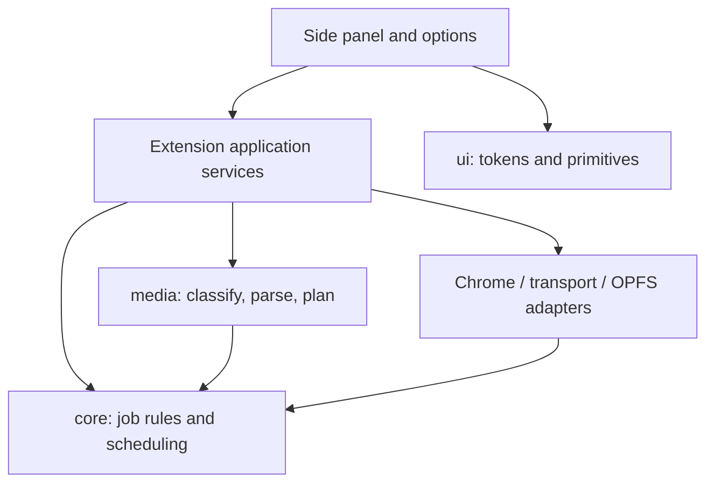

# Architecture proposal

Status: proposed foundation; only the reference experiment is executable today.

The [video experience spec](specs/video-download-experience.md) owns detailed
requirements; the [acceptance matrix](testing/video-download-acceptance.md) owns
verification gates. Folder/export changes are in
[decision 0002](decisions/0002-destination-backends.md).

## Dependency direction

`core` cannot import Chrome APIs, DOM, React, `ui` or application services.
`media` understands protocols and returns data/assembly plans; it does not start
privileged browser requests itself. `ui` does not start transfers. The extension
composition layer supplies transports, repositories, storage and export adapters.

## Runtime ownership

| Context | Owns | Does not own |
|---|---|---|
| MV3 service worker | Permissions, capture listeners, Chrome downloads API, coordination | Sole in-memory copy of long-job state |
| Side panel / options | User intent and presentation | Transfer lifetime |
| One offscreen document per profile | Worker lifecycle, File-backed URLs and export leases | Direct calls to every Chrome API |
| Worker | Segment execution, OPFS operations, media assembly | Arbitrary website-issued commands |
| Optional page adapter | A narrowly scoped, explicitly enabled fetch/capture action | General privileged proxy or hidden account export |

Offscreen documents have runtime messaging access, not the complete Chrome API;
the service worker handles download API calls. Closing the panel must not cancel
jobs. Service worker suspension, offscreen loss and browser shutdown are separate
recovery cases, not events to hide with a keepalive promise.
[Chrome offscreen reference](https://developer.chrome.com/docs/extensions/reference/api/offscreen)

## Primary contracts to implement

- `DownloadJob`: stable identity, selected resource/track, capability set and state.
- `TransferPlan`: ordered resources, init requirements, expected duration and assembly strategy.
- `Transport`: fetch in a declared permission/session context; bounded reads and cancellation.
- `JobRepository`: durable metadata, checkpoints and export references.
- `SegmentStore`: commit/read/verify/delete app-owned fragment data.
- `Exporter`: stage a final file, create a lease, initiate save, observe completion.
- `VideoRegistry` / `SourceResolver`: associate document/element epochs with
  candidate sources, representation identity and title evidence.
- `SourceLease` / `RefreshProvider`: optional known expiry, declared access context
  and supported refresh flow; never a generic signature generator.
- `DestinationManager`: permission-checked target references, name reservations
  and backend-specific export receipts.

These are conceptual interfaces; don't publish a plugin ABI before the first
working adapters stabilize. Remote configuration cannot contain executable code.

## Capture and identification

Use authorized network metadata, explicit URL entry and targeted inspection.
Standard extension request listeners do not supply arbitrary response bodies.
For a likely nonstandard playlist, fetch a bounded text prefix only when the user
has authorized the relevant hosts/context. Do not fetch every page request.

Remember tab/frame provenance and source epoch. A `.txt` response may be HLS;
`.png` may be media or a real image. Parse the bytes and reject unsupported layouts
instead of guessing from names or blindly stripping a prefix.

Host access must cover page/frame and requested media hosts where required.
Granting host access does not fix all 403 responses, browser partitioning or
expired signatures. Any page messaging path validates sender and allowed targets.
[Chrome webRequest reference](https://developer.chrome.com/docs/extensions/reference/api/webRequest)

Per-video overlays and the side panel consume the same registry. Frame-level
network evidence alone cannot safely associate several playlists with several
videos; ambiguous candidates require a chooser. Titles carry provenance and are
frozen when enqueued. Global automatic discovery needs explicit site access;
activeTab is a limited invocation mode. Keep Chrome runtime messaging as a small
JSON control plane; creator-context byte transport is an unresolved spike.

## Job states and honest progress

`queued → preparing → downloading → assembling → exporting → completed`

Additional states: `paused`, `waiting_for_source`, `interrupted`, `failed`, `cancelled`.
The domain implementation must define valid transitions and backend capabilities.

- A native single-file transfer uses Chrome's pause/resume support only when available.
- Segment download progress is committed segments or known bytes, with unknown totals explicit.
- 100% downloaded is not 100% saved. Assembly/export are visible phases.
- `completed` requires a validated artifact and a backend-specific export receipt:
  Chrome reporting completion, or a chosen-directory write closed and size-checked.
- Source expiry preserves work and moves to `waiting_for_source`; it is not silently retried forever.

## Bounded storage and recovery

Metadata goes into an IndexedDB repository; segment/output bytes use OPFS.
Keep only a bounded request window and bounded segment buffers in memory.
Proposed limits start at two active jobs, six managed requests globally, three
per job and one assembly. Native Chrome transfers have separate slot accounting.
These are unmeasured tuning policies, not universal browser connection limits.
Apply byte-budget backpressure during reads, writes and assembly.

Commit order: close/write-check the fragment or part, then advance the metadata
checkpoint. On restart, reconcile missing, orphaned and truncated files. Include
schema versions and migration/rejection behavior in durable records. Each job has
one writer/owner; epoch fencing prevents a previous source refresh writing late.

An updated signed source can attach to an existing job only after validating media
identity, rendition/track identity and segment layout. Do not globally strip URL
queries and assume the bytes are identical. Ambiguous matches create a separate
job or require an explicit supported recovery flow.

Known source deadlines are checked at dispatch and recovery as well as by
best-effort timers. Refresh providers are source-specific capabilities. Unknown
expiry and unavailable refresh are explicit states; a 403 alone proves neither
expiry nor the ability to renew. Managed HTTP resume verifies Range/If-Range
semantics and validators before appending bytes.

Quota exhaustion stops safely. Preserve incomplete work and offer explicit temp
cleanup; no claim of unlimited disk space. Proposed retention defaults must be
reviewed with actual quota behavior before release; no silent deletion policy is
implemented today.

## Assembly and export

For v0.1 continuous MPEG-TS, preserve the continuous transport stream and remux.
Do not reset timing at every grouped part using concat demuxer. fMP4/init segments,
separate tracks, discontinuities and encryption are different assembly plans and
are outside the first supported subset.

The proposed browser muxer mounts File-backed inputs and writes a seekable OPFS
output. It must pass a greater-than-2-GB test; final artifacts cannot require
reading the entire movie into an ArrayBuffer/Blob in RAM.

The offscreen document holds the final File-backed object URL lease. Its owner
revokes it only after confirmed completion, cancellation or a deliberate cleanup
transition, never after an arbitrary 60-second timer. Interrupted export can be
retried from the staged file without downloading every segment again.

Support explicit Chrome Downloads and chosen-directory modes, subject to the
capability gates. A top-level extension page owns user-gesture directory selection;
persisted handle access is rechecked. The Downloads filename option is relative
to Downloads, so managed HTTP streaming is required for arbitrary-folder jobs.
Unavailable selected targets pause saves without silent fallback. Stream final
bytes to a chosen handle, then close/verify; retain staging on failure.

## Verification

Use small generated H.264/AAC fixtures for ordinary CI, controlled request-failure
servers for recovery, and a separate large-media stress suite before releases.
Check segment coverage, output size, duration, tracks and selected decode regions.
Browser memory measurements must show no movie-size-proportional accumulation.
Keep media data and real-site credentials out of the repository.
