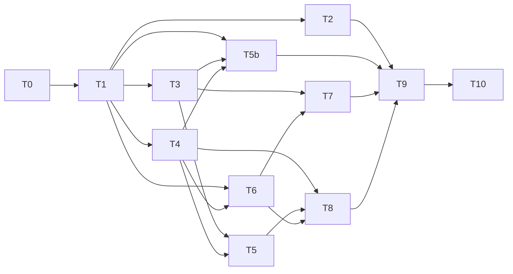

# Chrome Extension Implementation Plan

> **For agentic workers:** Use superpowers:executing-plans for inline execution or
> superpowers:subagent-driven-development for independent lanes when available.
> Equivalent ordinary tooling is supported; personal skill installations are not
> a project dependency. Follow the task checkboxes and TDD/evidence rules below.

**Goal:** Build the first installable Chrome extension slice: correct per-video
actions and names, a durable two-job queue, HTTP/clear TS HLS transfers, expiry-aware
recovery and verified saves to Downloads or a chosen directory.

**Architecture:** WXT/MV3 adapters surround browser-independent core/media rules.
Content scripts observe videos, the background coordinates permissions/jobs, and
offscreen/worker contexts own bounded transfers/storage. UI is a client of the
durable job repository, never the owner of a long transfer.

**Tech Stack:** pnpm workspaces, TypeScript strict, WXT, React, Vitest and Playwright;
IndexedDB metadata and OPFS staging. Node.js 24 for the product toolchain; preserve
Node 22/24 reference CI. Resolve compatible exact dependency versions in T0 and
commit a lockfile/packageManager version; do not install floating dependencies in CI.

**Spec:** [Video experience](../../specs/video-download-experience.md),
[acceptance matrix](../../testing/video-download-acceptance.md),
[architecture](../../architecture.md), [UI direction](../../../DESIGN.md).

## Readiness and global constraints

Requirements are sufficient to begin. The remaining unknowns are measured gates,
not reasons to repeat product discovery. Adopt per-video upper-right actions plus
side panel and a remembered chosen directory as working defaults.

- Proposed scheduler policy: two active jobs, six managed requests globally,
  three per job, one assembly; native transfers have separate slot accounting.
- Support HTTP(S) and completed, clear, muxed MPEG-TS HLS first. Blob discovery
  must attempt classification; real Blob transport has a separate gate. No DRM,
  WebRTC recording, DASH/fMP4 or arbitrary site refresh success promise.
- Use synthetic fixtures; no live-site CI, personal browser profiles or media.
- Keep core free of Chrome/DOM/React and media parsers free of privileged fetch.
- Preserve committed bytes; reject wrong representation/stale epochs; require
  actual backend completion before marking a job completed.
- No native companion, remote executable recipes, release tag, store publication,
  push or merge follows automatically from this implementation goal.
- Research/planning documents are intended input. Preserve any later uncommitted
  work; do not reset/clean the checkout to obtain a clean workspace.

## Review focus

1. Reused video element now plays an advertisement: T2 must invalidate old epochs.
2. New signed URL names different content: T7 must reject attachment without writes.
3. Server ignores Range: T5 must never append its 200 response to partial bytes.
4. Two jobs select the same filename: T4/T8 must reserve unique targets atomically.
5. Export succeeds but coordinator dies before checkpoint: T8/T10 must reconcile
   receipt/target and never report an unverified partial file as complete.

## Ownership and file map — planned, not existing modules

| Owner | Files / responsibility |
|---|---|
| Integrator | Root package.json, pnpm-workspace.yaml, pnpm-lock.yaml, tsconfig.json, vitest.config.ts, playwright.config.ts, CI and packages/core/src/contracts.ts |
| Core lane | packages/core/src/{jobs,scheduler,source-lease,naming}.ts and adjacent .test.ts |
| Capture lane | apps/extension/src/features/capture/{registry,correlate,titles,overlay}.ts and adjacent tests |
| Media lane | packages/media/src/{classify,hls,identity}.ts and adjacent tests |
| Platform lane | apps/extension/src/platform/{job-repository,segment-store,http-transport,destinations,exporter,muxer}.ts and tests/integration/*.test.ts |
| Composition/UI | apps/extension/src/features/{jobs,settings}/, src/messaging/, src/locales/, packages/ui/src/ |
| Browser evidence | tests/extension/{fixture,smoke,capture,transfer,recovery,security}.spec.ts, tests/server/, tests/manual/ and tests/stress/ |

WXT entrypoints: `apps/extension/entrypoints/background.ts`,
`video.content.ts`, `sidepanel/{index.html,main.tsx}`,
`options/{index.html,main.tsx}`, and `offscreen/{index.html,main.ts}`.
Keep unrelated helpers out of entrypoints. Offscreen is an unlisted page, not a
made-up MV3 manifest field. Put worker modules under `src/workers/` and bundle them
through WXT/Vite. `wxt.config.ts` owns global manifest settings; inspect the emitted
`.output/chrome-mv3/manifest.json` in tests.
[WXT entrypoints](https://wxt.dev/guide/essentials/entrypoints.html),
[manifest generation](https://wxt.dev/guide/essentials/config/manifest.html).

## Integration contracts — freeze in T1 before parallel work

These internal interfaces are starting contracts; changes require integrator
review and updating dependent tests together. Do not publish a plugin API.

```ts
type SourceRef = {
  tabId: number; frameId: number; documentId: string;
  elementId: string; epoch: number;
};
type DestinationRef =
  | { kind: 'downloads'; subfolder: string }
  | { kind: 'directory'; handleId: string };
type ResolveResult =
  | { kind: 'ready'; candidate: SourceCandidate }
  | { kind: 'choose'; candidates: SourceCandidate[] }
  | { kind: 'unavailable'; reason: string };
type SourceCandidate = {
  id: string; ref: SourceRef; url: string;
  kind: 'http' | 'blob' | 'hls'; representationId: string;
  access: 'extension' | 'creator'; evidence: string[];
};
type ExportReceipt =
  | { kind: 'downloads'; jobId: string; bytes: number; downloadId: number }
  | { kind: 'directory'; jobId: string; bytes: number; targetId: string };
type PartCommit = {
  jobId: string; epoch: number; resourceId: string;
  storageKey: string; bytes: number; digest: string;
};
```

Define `JobRecord` with schema version, revision, immutable selected title/source,
destination, state/reason, checkpoint and optional receipt. Store sensitive URLs
locally only as needed; diagnostics redact them. `JobRepository` exposes
`createOnce(key, job)`, `get(id)`, `list()` and
`compareAndSet(id, expectedRevision, next)`; all return Promises, CAS returns boolean.
Names/destination/source choices live in one atomic creation boundary.

## Execution rules and command contract

Every behavioral task: write a failing assertion → execute and observe the intended
failure → implement minimally → run focused and relevant broader suites → refactor
green → update evidence/task status → commit only intended paths when authorized.
A syntax/import/tool error is not behavioral RED. Configuration bootstrap uses
build/install/smoke verification, not artificial unit tests of config literals.
Do not test mock call counts instead of byte order, persisted state or saved output.

T0 creates these scripts; they do **not exist today**:

| Command | Required behavior |
|---|---|
| pnpm typecheck | All product TS projects, strict |
| pnpm lint | Product source and dependency-boundary checks |
| pnpm test:unit | Core/media and extension pure logic tests; no watch mode |
| pnpm test:integration | Real local HTTP/disk and browser-backed storage tests as appropriate |
| pnpm build | Production MV3 extension |
| pnpm test:extension | Build then installed-extension Playwright suite |
| pnpm test | Unit + integration + existing seven reference tests |
| pnpm test:stress | Explicit opt-in generated >2 GB and memory suite |

Use `pnpm exec vitest run <test-path>` for focused RED/GREEN; browser specs use
`pnpm exec playwright test <spec-path>`. T0 documents/configures their actual
projects so these commands run from root. No `passWithNoTests`, hidden skipped
release gates or fake success scripts. Add native-picker procedure separately;
it cannot be represented as an always-passing automated script.

## M0 — Reproducible extension and feasibility gates

### T0: Installable shell and browser test runner

**Files:** root toolchain/config above; `apps/extension/package.json`,
`wxt.config.ts`, background/options/sidepanel entrypoints;
`tests/extension/fixture.ts`, `smoke.spec.ts`, `.github/workflows/ci.yml`.
**Consumes:** existing docs only. **Produces:** production build, isolated persistent
browser fixture exporting `test`/`expect` with `context`/`extensionId` fixtures,
scripts and a recorded baseline browser version.

- [ ] Bootstrap pinned compatible tooling and build a minimal MV3 shell; no downloader behavior.
- [ ] Write smoke assertions for loaded extension worker and opening options UI;
  run `pnpm exec playwright test tests/extension/smoke.spec.ts` and observe failure
  for missing expected UI/behavior rather than an absent test runner.
- [ ] Implement the minimal options heading and toolbar/side-panel wiring; rerun
  smoke and `pnpm build`, `pnpm typecheck`. Assert manifest v3 and no unexpected hosts.
- [ ] Run reference/docs checks. Add pinned CI actions and real product commands;
  retain existing checks, and record which checks CI actually runs.

First behavioral test in smoke.spec.ts (run against the built shell before adding
the heading; fixture derives extensionId from the loaded worker URL):

```ts
test('installed options page identifies gDownloader', async ({ context, extensionId }) => {
  const page = await context.newPage();
  await page.goto(`chrome-extension://${extensionId}/options.html`);
  await expect(page.getByRole('heading', { name: 'gDownloader', exact: true })).toBeVisible();
});
```

Use Playwright's bundled Chromium, `channel: 'chromium'`, a temporary persistent
profile and `--load-extension`/`--disable-extensions-except` pointing to the build.
Do not use a personal profile or assume ordinary Chrome/Edge support these flags.
Opening a sidepanel URL in a tab tests its page, not actual browser panel integration;
record native panel behavior separately.
[Official extension test setup](https://playwright.dev/docs/chrome-extensions).

### T1: Shared contracts, fixture server and capability evidence

**Files:** `packages/core/src/contracts.ts`, `tests/server/{server,fixtures}.ts`,
`tests/extension/capabilities.spec.ts`, `tests/manual/capabilities.md`,
`docs/implementation/capability-evidence.md`.
**Consumes:** T0 build/runner. **Produces:** contracts above and independently recorded gates.

- [ ] Define contracts and fixture endpoints for two origins/videos, TS HLS,
  creator Blob, controllable range/expiry, failure injection and refresh generation.
  The server logs exact requests; no third-party network dependency.
- [ ] Write failing browser assertions for permitted frame/video association,
  creator Blob byte hash, OPFS write/read hash and wrong-source rejection (E02/04/05/15).
- [ ] Implement only enough adapters to measure these capabilities; keep spike code
  separate from production until its regression tests drive promotion.
- [ ] Run browser gates. In a real user click, test the extension options directory
  picker, handle persistence after profile reopen and permission recovery (E16).
- [ ] Measure >2 GB staged/exported output for each destination; distinguish raw
  export from media mux capacity. Benchmark a bundled disk-backed TS→MP4 mux path
  with output duration/tracks/decode checks; review its license before integration.
- [ ] Record browser/OS, command/procedure, bytes/hash, memory scope and result per
  gate. Freeze minimum Chrome version only after API availability and tests agree.

Do not pick a mux library on reputation alone. Gate failure must produce an ADR
with observed limitation and options. No silent substitution of OPFS for a native
folder, giant in-memory output, desktop merge or guessed “supported” result.
Independent core/capture work may continue; dependent support claims remain pending.

## M1 — Parallel domain, capture and durable storage

### T2: Video registry, overlay and source correlation — capture lane

**Files:** capture files above, `entrypoints/video.content.ts`,
`tests/extension/capture.spec.ts`.
**Consumes:** T1 SourceRef/ResolveResult. **Produces:**
`observeVideos(root: Document | ShadowRoot, emit: (ref: SourceRef) => void): () => void`
and `resolve(ref: SourceRef): Promise<ResolveResult>` through an injected registry.

- [ ] RED: E01–05 tests assert one keyboard-accessible action, correct title/source
  candidates for two videos, chooser on ambiguity, epoch invalidation on ad/SPA
  replacement, and fallback when access/fullscreen disallows an overlay.
- [ ] Run capture unit/browser tests; implement bounded observations, positioning
  and lifecycle cleanup; do not auto-fetch full media when detecting elements.
- [ ] GREEN: run capture suite, verify frame permissions and zero stale jobs after
  navigation. Record whether closed-shadow and related-frame cases actually pass.

### T3: Durable queue and scheduling — core lane

**Files:** `packages/core/src/{jobs,scheduler}.ts`, adjacent tests.
**Consumes:** contracts, injected repository/clock/transport ports.
**Produces:** `enqueue(input: EnqueueInput): Promise<JobRecord>`,
`pause(jobId: string): Promise<void>`, `cancel(jobId: string): Promise<void>`;
`EnqueueInput` contains candidate, frozen title, destination and explicit duplicate flag.

- [ ] RED: E06/09/10 assert idempotent creation, two active jobs, six global/three
  per-job managed requests, one assembly, fairness, independent cancellation and
  no completion without receipt. Native jobs count as active but have separate request accounting.
- [ ] Run focused tests against deterministic clock and real scheduler logic;
  implement minimal state machine and byte-budget backpressure.
- [ ] GREEN: restore persisted queued/paused/interrupted jobs; old epoch callbacks
  cannot advance checkpoints; run all core tests.

### T4: Storage transactions and safe names — platform + naming lanes

**Files:** job-repository/segment-store adapters, core naming.ts, capture titles.ts,
`tests/integration/{storage,naming}.test.ts`.
**Consumes:** JobRepository/PartCommit, title evidence and DestinationRef.
**Produces:** `commitPart(part: PartCommit): Promise<void>`,
`recoverJob(jobId: string): Promise<JobRecord>`,
`suggestName(evidence: TitleEvidence[], container: string): NameSuggestion` and
`reserveName(jobId: string, destination: DestinationRef, suggested: string): Promise<string>`.
Define TitleEvidence as `{text, provenance, confidence, matchesVideo}` and
NameSuggestion as `{filename, provenance, confidence}` in the owned naming module.

- [ ] RED: E07/08/12 assert video-specific metadata ranking, frozen fallback title,
  Unicode/reserved/traversal name handling, concurrent collisions, truncated/orphan
  part recovery and crashes before/after close/checkpoint.
- [ ] Implement real IDB/OPFS adapter behind ports. Close and verify bytes/digest
  before metadata advancement; CAS guards revisions and epochs.
- [ ] GREEN: browser-backed IDB/OPFS recovery tests plus naming tests. Node disk
  adapters alone do not validate browser storage semantics.

T4 storage and naming can run as separate sublanes after contracts are frozen;
only the integrator edits contracts or workspace manifests.

## M2 — Transfer, expiry and final output

### T5: Managed HTTP streaming/resume and native adapter

**Files:** platform http-transport.ts, `src/platform/chrome-downloads.ts`,
`tests/integration/http.test.ts`, `tests/extension/transfer.spec.ts`.
**Consumes:** scheduler slots, permission policy, segment store and job epochs.
**Produces:** `runHttp(jobId: string, signal: AbortSignal): Promise<void>` and a
native adapter emitting typed progress/completion into the same job service.

- [ ] RED: E09/11/14 cover 206 offsets/totals, changed validator/200, 416, unavailable
  Range, stalled/truncated bodies, 429/Retry-After, finite retries and cancellation.
- [ ] Implement bounded reads, checked validators and explicit restart capability.
  Permission-check redirects/targets; credentials are access-context-specific.
- [ ] GREEN: server logs prove correct ranges and no byte duplication; a native
  download completes only after Chrome's actual event. Run integration suite.

### T5b: Creator-context Blob transport — gated subtask

**Files:** `src/platform/blob-transport.ts`, `tests/extension/blob.spec.ts`.
**Consumes:** T1 creator-context transport evidence, T3 slots and T4 storage.
**Produces:** `runBlob(jobId: string, signal: AbortSignal): Promise<void>` only for
verified contexts, plus a capability result for inaccessible/revoked sources.

- [ ] RED: E04/09/19 assert synthetic Blob bytes/hash, revocation before/during
  transfer, page navigation, cancellation and no reads without an approved job.
  Increase input size and slow the sink to test byte-budget backpressure.
- [ ] Implement the bounded route proven in T1, documented in an ADR; do not assume
  runtime messaging accepts transferable buffers or page-context cookies work
  from an extension-origin fetch. No giant serialized payload or whole-file RAM copy.
- [ ] GREEN: installed-extension bytes match and observed memory remains bounded.
  If no safe route passes, return an explicit unavailable capability; discovery
  still offers an attempt, but the goal must report generic Blob transfer unmet.

### T6: Clear TS HLS plan and assembly

**Files:** media classify.ts/hls.ts/identity.ts, platform muxer.ts,
`tests/integration/hls.test.ts`, synthetic media fixtures/generator.
**Consumes:** T1 mux gate, transport/store. **Produces:**
`parseHls(text: string, baseUrl: string): HlsParseResult` (master/media/unsupported
discriminated result); ordered `TransferPlan` with resources, identity evidence and
assembly strategy. Assembly adapter returns a staged artifact reference/size.

- [ ] RED: E04/12 assert .txt/text-plain HLS detection, ordered TS bytes, explicit
  rejection of unsupported encrypted/separate-track/fMP4/discontinuous/live layouts,
  init/layout checks and truncated resource recovery.
- [ ] Implement parsing without network side effects and bounded transfer/assembly
  using the measured mux path. Do not blindly copy prototype URL fingerprinting.
- [ ] GREEN: generated H.264/AAC output has expected tracks, duration and sampled
  decode; grouped parts do not accumulate timestamp resets. Run media/integration tests.

### T7: Source leases and identity-safe refresh

**Files:** core source-lease.ts, media identity.ts (coordinate ownership with T6),
`src/features/jobs/refresh.ts`, `tests/integration/expiry.test.ts`.
**Consumes:** source epochs, parsed representation evidence and injected clock.
**Produces:** `refreshSource(jobId: string, signal: AbortSignal): Promise<ResolveResult>`
through an optional RefreshProvider; job service attaches only a proven match.

- [ ] RED: E13–15 assert dispatch-time resolution, known deadline safety margin,
  unknown expiry, sleep/skew, provider missing/failing, non-expiry 403, changed
  rendition and late old responses. New signature alone never authorizes append.
- [ ] Implement source lease policy and a synthetic provider; generic sources
  without renewal use fresh authorized observations/user recovery, not fabricated URLs.
- [ ] GREEN: refreshed unchanged HLS reuses committed resources; wrong content
  leaves them untouched; no provider produces actionable waiting_for_source.

### T8: Destinations, export receipts and recovery

**Files:** platform destinations.ts/exporter.ts, options settings,
`tests/integration/export.test.ts`, `tests/manual/directory-save.md`.
**Consumes:** staged artifact, name reservation and T1 destination gate.
**Produces:** `exportArtifact(jobId: string, signal: AbortSignal): Promise<ExportReceipt>`.

- [ ] RED: E08/16/17 assert picker cancellation preserves settings, permission loss
  pauses, disconnected target never falls back, save failure retains staging and
  retry does not fetch again. Assert crash-after-close/before-receipt reconciliation.
- [ ] Implement Chrome event/URL lease ownership and chosen-folder streaming
  close/size verification. Directory handles remain extension-private; no whole-file ArrayBuffer.
- [ ] GREEN: actual saved bytes/hash match in both backends. Validate native picker
  manually when automation intercepts it; record that distinction explicitly.

## M3 — Compose a usable extension

### T9: Permission policy, validated messaging and UI

**Files:** background/content/offscreen entrypoints, src/messaging/, job/settings
features, locales, packages/ui/src/ and `tests/extension/security.spec.ts`.
**Consumes:** T2–8 contracts/services. **Produces:** complete button→queue→save flow.

- [ ] RED: E02/03/19 and UI tests assert forged page commands, navigation, arbitrary
  targets and revoked access cannot fetch/write; keyboard flows and visible
  queued/resolving/download/assembly/export/failure/completed states are truthful.
- [ ] Implement explicit per-site/global optional host access, then register/remove
  content scripts for granted sites. Already-open pages need deliberate injection.
  Media CDN hosts require separate approval where necessary; no install-time silent
  all-site capture. Proposed API permissions: activeTab, scripting, storage,
  downloads, sidePanel, offscreen, webRequest and alarms, justified/tested as used.
- [ ] Validate sender document/frame, approved job/resource, revision/epoch and
  destination in the extension. MAIN-world hooks only observe; no page command proxy.
- [ ] Compose real services. Worker lifecycle survives panel closure; SW listeners
  register at startup and recover from durable metadata. Bundle executable assets
  locally and apply the offscreen API's declared reason/justification.
- [ ] Return `ready` only when the selected candidate has a usable transport and
  media adapter. Resolve unsupported creator Blob contexts to `unavailable`, never
  enqueue a job that pretends a MediaSource object URL is a complete file.
- [ ] GREEN: click two distinct videos, edit title/target, observe simultaneous
  transfers and inspect saved files. Test actual panel/toolbar behavior separately
  from a sidepanel page opened in a browser tab.

Optional hosts and dynamic injection follow the
[permission model](https://developer.chrome.com/docs/extensions/develop/concepts/declare-permissions)
and [scripting API](https://developer.chrome.com/docs/extensions/reference/api/scripting).
Offscreen capabilities are restricted; it is not a general Chrome API context or
an indefinite service-worker keepalive.
[Offscreen API](https://developer.chrome.com/docs/extensions/reference/api/offscreen).

## M4 — Recovery, scale and handoff

### T10: Whole-system failure and release evidence

**Files:** `tests/extension/recovery.spec.ts`, `tests/stress/`, `tests/manual/`,
capability-evidence.md, acceptance matrix, install/recovery docs and CI.
**Consumes:** T9 composed build. **Produces:** reproducible unpacked ZIP/build,
installation instructions and honest support/evidence matrix, not a store release.

- [ ] RED: reproduce E10/17/18 failure paths in the composed extension: close panel,
  suspend/restart coordinator, lose offscreen context, restart browser, quota/full
  target and crash during export. Assert retained work and no unverified completion.
- [ ] Fix through TDD in the owning modules; run all E01–19 applicable cases.
  Document unsupported cases explicitly; do not convert failed required gates into skips.
- [ ] Run typecheck/lint/test/build/extension checks and current docs/reference
  checks. Run opt-in large-file suite and native folder/panel procedures.
- [ ] Record actual output hash/size, tracks/duration/decode probes, measured memory
  at increasing sizes, temporary disk use and recovery request logs for both targets.
- [ ] Review permission/dependency/license diff, generated build reproducibility and
  redacted diagnostics. Update README/roadmap/status to match executed evidence.

## Parallelization and integration order



With four agent slots: integrator owns contracts/config/integration; at most three
workers own capture, core and platform/media lanes. Run only ready tasks. Separate
worktrees/branches per lane; no simultaneous shared-file edits. T6/T7 identity.ts
changes are sequential or explicitly handed off. Naming and storage may split
only when capacity permits; avoid context overhead for tiny tasks.

Parallel feature work begins after T1 contracts and fixture expectations freeze.
Before branching workers, put reviewed planning inputs, contracts and fixture
baseline into the integration base commit when local commits are authorized.
Worktrees do not inherit another worktree's uncommitted files; never send workers
to stale main without the plan/contracts. Preserve unrelated working-tree edits.
Use the same pinned lockfile; only the integrator changes dependencies/CI. Merge
dependency order, run combined suites and review source/destination boundaries.
Passing isolated lane tests does not complete T9/T10. If agents are unavailable,
execute the same ready tasks sequentially without changing the acceptance gates.

## Goal execution handoff

Use [execution status](../../implementation/status.md) as the durable task/evidence
ledger. Next implementation request should start at the first unchecked ready task,
not repeat planning. User-requested parallelism is authorized for independent lanes;
capability failures require evidence/ADR, not an invented success or immediate
whole-project cancellation. Keep independent work moving.

Real OS permission/picker interaction may require a targeted user handoff. Prepare
the installed build and exact procedure first; never count missing interaction as
approval or as a successful test. Respect the active goal tool's own lifecycle rules.
